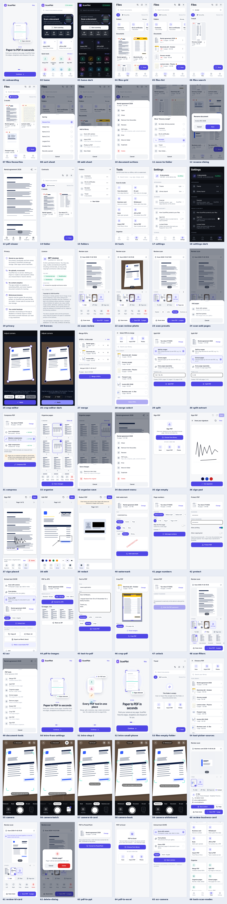

# ScanPilot — free document scanner & PDF editor

> **Scan anything. Edit everything. Manage your documents. No subscription. No watermark.**

ScanPilot is an offline-first document scanner and PDF toolkit for Android
(primary) and iOS, built with React Native, Expo and strict TypeScript.
Documents never leave the device unless the user explicitly shares or exports them.

**Status:** Milestones 1–5 complete — scanner, filters, 21 PDF tools, editing & signing, offline OCR, app lock — see [IMPLEMENTATION_PLAN.md](IMPLEMENTATION_PLAN.md).



| Doc | Contents |
| --- | --- |
| [IMPLEMENTATION_PLAN.md](IMPLEMENTATION_PLAN.md) | Milestones, status, what's next |
| [docs/TECHNOLOGY.md](docs/TECHNOLOGY.md) | Stack, scanner/PDF/OCR library evaluation, licences |
| [docs/ARCHITECTURE.md](docs/ARCHITECTURE.md) | Layers, data model, storage layout |
| [THIRD_PARTY_NOTICES.md](THIRD_PARTY_NOTICES.md) | Licences of bundled software |

## What works today

**Everyday PDF tools (Milestone 5)** — Sign, Edit (text, pen, highlight, shapes, whiteout, images), Redact (secure), Watermark, Page numbers, Protect/Unlock (AES-256), Crop, Rotate, Repair, Extract text (offline OCR, English & Hindi), PDF to Word, PDF to JPG, Text to PDF, Print, App lock & Locked folder, scan filters.

**PDF toolkit (Milestone 4)**
* Merge, Split (ranges / extract / every page), Compress (Android; low/medium/high with size estimates), Organise pages (rotate, reorder, duplicate, delete, extract) — from Home, Tools or any document's ⋮ menu. Results can be opened or shared immediately; originals are kept unless you choose "Replace the original".

**Scanner (Milestone 2)**
* Camera scanning with Google ML Kit Document Scanner (Android) / VisionKit (iOS): live edge detection, auto-capture, flash, perspective correction, multi-page, retakes — without the Android CAMERA permission.
* Review screen: page thumbnails, rotate, crop/adjust corners (manual perspective correction), retake, delete, reorder, add pages from camera or photos, rename.
* Document types: Original, A4, Letter, Receipt, Business card, ID card, Book/notes.

**Foundation (Milestone 1)**

* Home dashboard: hero actions, tool grid, recent documents, favourites, folders.
* Document library: grid/list views, search, favourites filter, sorting (name, date, size, recently opened), pull-to-refresh.
* Folders: create, rename, delete (documents are kept), move documents between folders.
* Import PDFs (multi-select, header validation) and convert photos to a PDF (ordered multi-select, resized & re-encoded on device).
* Native PDF viewer with page indicator, password-protected PDF support, page-count backfill.
* Document actions: share, save to device (Android folder picker), rename, favourite, move, duplicate, delete.
* Scan modes: Document, Whiteboard, Book (auto page split), ID card (both sides on one A4 page), Business card (read and save as a contact).
* PDF → PowerPoint and PDF → Excel (on-device), editable OCR text from camera, photos or PDFs.
* In-app confirmation dialogs and toasts, skeleton loading.
* ScanPilot's own document camera: frame guide, flash, grid, batch pages, on-device edge detection and auto-crop, then a review screen with live filter previews (the system scanner remains available in Settings).
* Camera scan, PDF import and photos → PDF available inside every tool's document picker, in empty Files/folders (plus a floating Scan button) and as **Add pages** in the document viewer.
* Professional light/dark/system design system (Inter type, Lucide icons), animated start-up screen, swipeable onboarding, progress dialogs, privacy page, MIT licence page, storage usage & temp-file cleanup.
* Tested PDF engine (pdf-lib): images→PDF, merge, split, extract, rotate, reorder, delete, duplicate — UI arrives in Milestone 4.

Tools that need Android's native renderer (edit, sign, redact, OCR, compress, PDF→JPG/Word) show
**“Soon” on iOS** until the iOS renderer lands — no button silently does nothing.

## Requirements

| Tool | Version |
| --- | --- |
| Node.js | 22.13+ or 24.3+ (LTS recommended) |
| npm | 10+ |
| JDK | 17 (e.g. Temurin 17, or the JBR bundled with Android Studio) |
| Android Studio | Latest stable, with **Android SDK Platform 37**, **Build-Tools 37**, **NDK 27.1.12297006**, Platform-Tools |
| A real Android phone | Android 7.0+ (API 24+), USB debugging enabled |
| iOS (optional) | macOS + Xcode 26+, CocoaPods |

Set `ANDROID_HOME` (macOS: `~/Library/Android/sdk`, Linux: `~/Android/Sdk`,
Windows: `%LOCALAPPDATA%\Android\Sdk`) and add `$ANDROID_HOME/platform-tools` to `PATH`.

## Why a development build (not Expo Go)

ScanPilot uses native modules that are **not included in Expo Go**:
`react-native-pdf`, `react-native-blob-util`, `react-native-pdf-thumbnail`,
ScanPilot's own module `modules/scanpilot-native` (Android: ML Kit document
scanner + PdfRenderer) and `react-native-document-scanner-plugin` (iOS VisionKit). On Android the
scanner also needs **Google Play services** on the device. You run the
app in a **development build** — your own debug APK containing these modules
plus `expo-dev-client`. JavaScript changes still hot-reload from Metro.

## Run on Android — local build

```bash
git clone https://github.com/abishek-k-dev/scanpilot.git
```

```bash
cd scanpilot
```

```bash
npm install
```

Connect your phone over USB (accept the debugging prompt) and confirm it's visible:

```bash
adb devices
```

Build, install and launch the development build (first build takes several minutes):

```bash
npx expo run:android
```

This runs `expo prebuild` (generates the git-ignored `android/` folder from
`app.json` + config plugins), compiles with Gradle, installs the APK, and starts Metro.
Afterwards, for JS-only changes just start Metro and open the installed app:

```bash
npm start
```

Rebuild natively (`npx expo run:android`) whenever you add/upgrade a native
dependency or change `app.json` plugins. To regenerate native projects from scratch:

```bash
npm run prebuild
```

Release-mode build on a device (no Metro, closer to production performance):

```bash
npx expo run:android --variant release
```

## Get an installable APK from GitHub Actions

Every push to the branch runs `.github/workflows/android-apk.yml`, which builds a
standalone release APK (signed with the public debug key — fine for testing, not
for Google Play). Download it from the run's **Artifacts → ScanPilot-apk**, or start
it manually: **Actions → Android APK → Run workflow**.

## Run on Android — cloud build with EAS (no Android Studio needed)

```bash
npx eas-cli@latest login
```

```bash
npx eas-cli@latest build --profile development --platform android
```

Install the APK from the link/QR code EAS prints, then:

```bash
npm start
```

`preview` produces an installable release APK; `production` produces an AAB for Google Play (see `eas.json`).

## Run on iOS (macOS)

```bash
npx expo run:ios --device
```

or in the cloud:

```bash
npx eas-cli@latest build --profile development --platform ios
```

## Quality checks

```bash
npm run verify
```

runs, in order:

| Script | What it does |
| --- | --- |
| `npm run typecheck` | `tsc --noEmit` (strict) |
| `npm run lint` | ESLint (Expo config + React Compiler rules + type-aware floating-promise checks) |
| `npm test` | Jest: PDF engine, page ranges, query builder, path/name utils, UI smoke tests |
| `npm run licenses:check` | Fails on copyleft/unknown licences in production dependencies |

Validate generated PDFs with independent readers (poppler `pdfinfo` + Python `pypdf`):

```bash
npm run test:pdf-readers
```

## Screenshots

```bash
npm run screenshots
```

Builds a web demo with in-memory sample data (`SCANPILOT_DEMO=1`, see `metro.config.js` and `src/demo/` — never part of real builds), drives it with Playwright, and writes `docs/screenshots/`. The native viewer and scanner are replaced by stand-ins in this mode, so it's a design review tool, not a substitute for device testing.

## Project structure

```
modules/scanpilot-native/  Local Expo module (Kotlin): ML Kit scanner + PdfRenderer
src/
  app/                 Expo Router screens (routes only; tool/ = PDF toolkit)
    (tabs)/            Home, Files, Tools, Settings
    document/[id].tsx  PDF viewer
    folder/[id].tsx    Folder contents
  components/
    ui/                Design system (Button, Card, ActionSheet, TextPromptModal, …)
    documents/         Document grid/list, thumbnails, library browser
    pdf/               PdfViewer (native) + .web fallback
  hooks/               Data + action hooks used by screens
  services/            Business logic (no React): pdf, library, import, share, storage, thumbnails
  db/                  SQLite connection, migrations, repositories, query builder
  native/              Native adapters (scanner, PDF page renderer)
  services/tools/      Merge, split, compress, organise orchestration
  services/scan/       Scan session: geometry, perspective warp, page processing, PDF creation
  demo/                Screenshot-build stand-ins (only used when SCANPILOT_DEMO=1)
  stores/              Zustand stores (settings, library revision)
  theme/               Tokens (colour, spacing, type) + useAppTheme
  features/            Tool registry, licence list
scripts/               Licence audit, PDF reader validation
docs/                  Technology decisions, architecture
```

## Privacy model

* Files live in the app's private storage; metadata in a local SQLite database.
* No account, no backend, no analytics or ad SDKs.
* Imports use system pickers — no broad storage permission. Android `allowBackup` is disabled.
* Permissions blocked in the manifest: camera (ML Kit's scanner runs in Google Play services, so ScanPilot itself never needs it), microphone, legacy storage, overlay.

## Troubleshooting

* **“Native module … not found / RNPDFPdfView not found”** — you're in Expo Go or an old build. Rebuild with `npx expo run:android`.
* **Gradle: “SDK location not found”** — set `ANDROID_HOME` or create `android/local.properties` with `sdk.dir=…`.
* **Gradle: unsupported Java version** — use JDK 17 (`java -version`); in Android Studio set Gradle JDK to 17.
* **Device not listed by `adb devices`** — enable USB debugging, accept the RSA prompt, try another cable.
* **“The camera scanner needs Google Play services”** — the device has no Play services (e.g. Huawei); use “Choose photos” and the crop editor.
* **Metro not reachable from the phone** — same Wi-Fi network, or `adb reverse tcp:8081 tcp:8081`.

## Licence

ScanPilot is released under the [MIT License](LICENSE). The app shows the same
text in **Settings → Licence** (`src/features/appLicense.ts` — keep the two in sync).
Third-party components keep their own licences — see [THIRD_PARTY_NOTICES.md](THIRD_PARTY_NOTICES.md).
